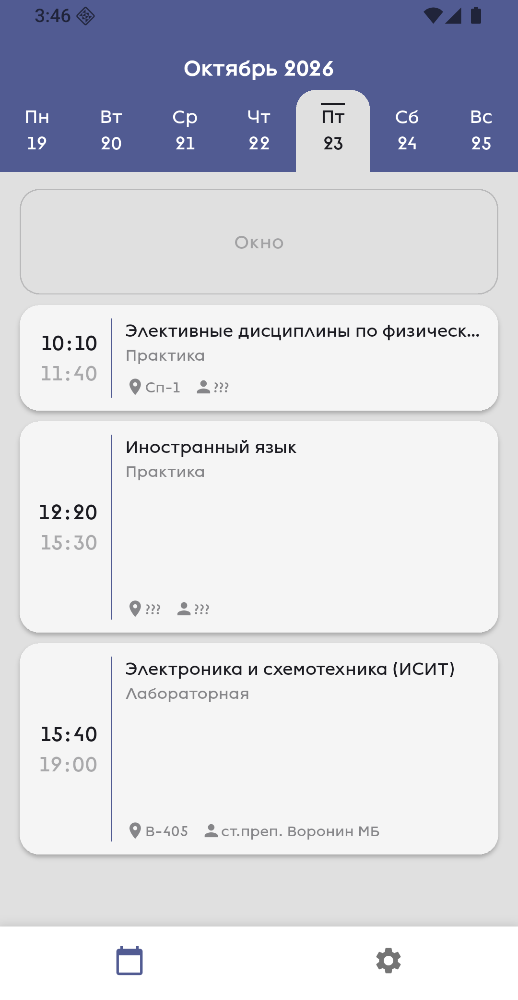
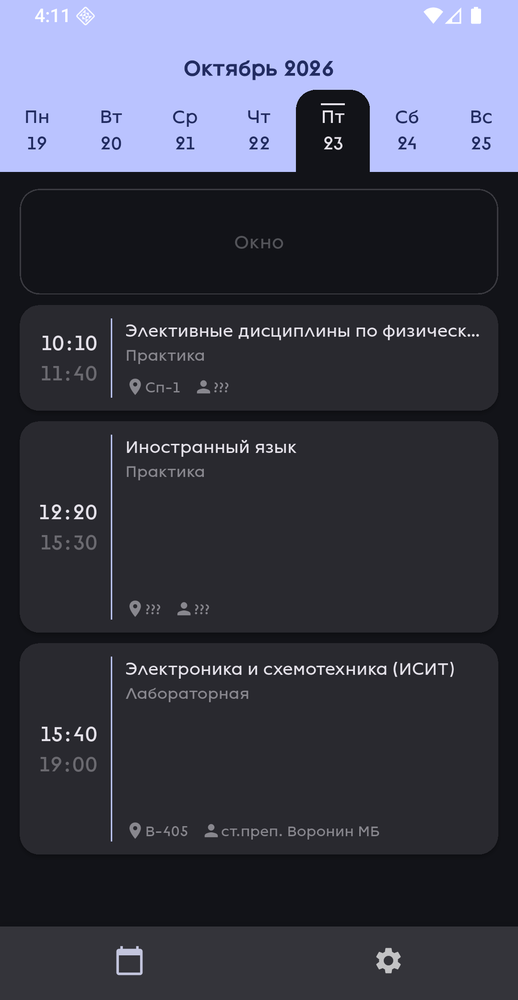

# ЯГТУ Расписание

Мобильное приложение (в данный момент работающее только на Android) для студентов
ЯГТУ, в котором вы можете узнать ваше расписание.

<p align=center>
  
  
</p>

## Разработка

Чтобы собрать необходимо иметь [Flutter](https://flutter.dev/):
```console
$ flutter run         # в разработке
$ ./build_release.sh  # чтобы собрать release-версию
```

## Заметки

Проект использует API [YSTUty](https://github.com/YSTUty/) для получения списка групп и расписания
группы в JSON-формате. Несмотря на то, что ребята из YSTUty разрабатывают web-приложение
и telegram-бота, мобильный опыт использования их продуктов всё равно оставляет желать
лучшего. Учитывая преобладание мобильной аудитории, это превращается в разочарование.
Сама инициатива крутая, но выбор платформ плохой. Я могу объяснить такое решение только тем,
что публикация приложений в PlayStore и AppStore достаточно затруднительна. Для обеих платформ
необходимо плататить за аккаунт разработчика, а выпустить ios-приложение вообще можно
только из под MacOS. Android спасает только возможность установки откуда угодно, но это может
оказаться сложным для неопытного человека.
